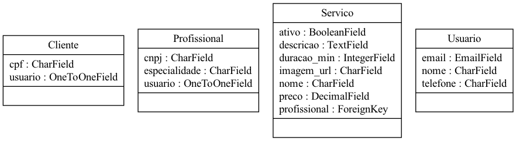

# Atividade II.III: Diagrama de Classes UML

## Ferramenta utilizada

Foi utilizado o **pyreverse**, incluído no pacote **pylint** (já presente em [requirements.txt](requirements.txt)), para gerar automaticamente o diagrama de classes UML das classes de domínio da aplicação.

O pyreverse analisa estaticamente o código Python (via `astroid`) e não exige a execução do servidor Django, sendo adequado para uso em linha de comando e em pipeline de CI.

## Classes de domínio analisadas

O diagrama foi gerado a partir do módulo [agendeja_rest/servicos/models.py](agendeja_rest/servicos/models.py), que concentra as classes de domínio do sistema:

- `Usuario`
- `Cliente`
- `Profissional`
- `Servico`

## Comando (linha de comando)

```powershell
cd agendeja_rest
pyreverse -o png -p AgendeJaDominio --output-directory ../docs/uml servicos.models
```

- `-o png` → formato de saída da imagem
- `-p AgendeJaDominio` → prefixo do nome do arquivo gerado
- `--output-directory` → diretório onde a imagem é salva

> Requer o **Graphviz** instalado no sistema (`dot`), usado pelo pyreverse para renderizar a imagem.

## Integração no pipeline (CI)

O pipeline de build ([.github/workflows/build.yml](.github/workflows/build.yml)) foi atualizado com três novos passos, executados logo após a validação do projeto Django:

1. **Instalar Graphviz** → `sudo apt-get install -y graphviz`
2. **Gerar diagrama de classes UML (domínio)** → executa o `pyreverse` sobre `servicos.models`
3. **Publicar diagrama de classes UML** → publica a imagem gerada como artefato do workflow (`actions/upload-artifact`), disponível para download na aba Actions de cada execução

Dessa forma, a cada push/pull request o diagrama é regenerado e fica sempre atualizado em relação ao modelo de domínio atual.

## Diagrama gerado



O diagrama representa as quatro classes de domínio com seus respectivos atributos e tipos, incluindo os relacionamentos (`ForeignKey`, `OneToOneField`) entre `Servico`/`Profissional` e entre `Cliente`/`Profissional`/`Usuario`.

## Fontes

- [Pylint: pyreverse](https://pylint.readthedocs.io/en/latest/pyreverse.html)
- [Graphviz](https://graphviz.org/)
- [GitHub Actions: upload-artifact](https://github.com/actions/upload-artifact)
